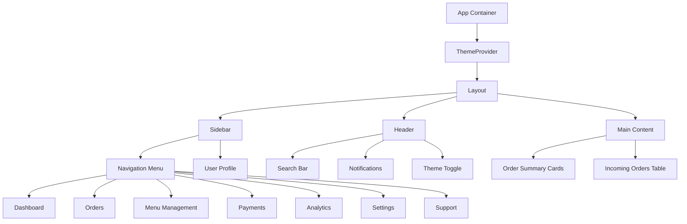

# Design Document: Dashboard UI Theme Switcher

## Overview

A modern, responsive web UI dashboard for the ReadyBell restaurant notification platform that displays order management and analytics with seamless light/dark theme switching. The dashboard serves restaurant staff to monitor incoming orders, track order status in real-time, and manage their operational workflow. The design emphasizes usability across devices (mobile, tablet, desktop) with accessible color schemes and persistent theme preferences using localStorage.

## Architecture

The dashboard follows a component-based modular architecture with clear separation of concerns:



## Color Scheme Definitions

### Light Mode Theme
```typescript
{
  primary: '#0066CC',           // Professional blue
  secondary: '#F0F4FF',         // Light blue background
  accent: '#FF6B35',            // Warm orange for alerts
  background: '#FFFFFF',         // Pure white
  surface: '#F8F9FA',           // Subtle gray for cards
  border: '#E0E0E0',            // Light gray borders
  text: {
    primary: '#1A1A1A',         // Near-black
    secondary: '#666666',       // Medium gray
    muted: '#999999',           // Light gray
    inverse: '#FFFFFF'          // White on dark backgrounds
  },
  status: {
    success: '#10B981',         // Green
    warning: '#F59E0B',         // Amber
    error: '#EF4444',           // Red
    info: '#3B82F6'             // Blue
  },
  chart: {
    primary: '#0066CC',
    secondary: '#10B981',
    tertiary: '#F59E0B'
  }
}
```

### Dark Mode Theme
```typescript
{
  primary: '#60A5FA',           // Brighter blue for dark
  secondary: '#1E3A5F',         // Dark blue background
  accent: '#FF8A50',            // Lighter orange
  background: '#0F1419',        // Near-black background
  surface: '#1A202C',           // Dark gray for cards
  border: '#374151',            // Medium-dark gray borders
  text: {
    primary: '#F3F4F6',         // Near-white
    secondary: '#D1D5DB',       // Light gray
    muted: '#9CA3AF',           // Medium gray
    inverse: '#1A1A1A'          // Dark on light backgrounds
  },
  status: {
    success: '#34D399',         // Bright green
    warning: '#FBBF24',         // Bright amber
    error: '#F87171',           // Bright red
    info: '#60A5FA'             // Bright blue
  },
  chart: {
    primary: '#60A5FA',
    secondary: '#34D399',
    tertiary: '#FBBF24'
  }
}
```

## Components and Interfaces

### 1. ThemeProvider Component

Manages theme state and persistence across the application.

```typescript
interface Theme {
  mode: 'light' | 'dark'
  colors: ColorScheme
  spacing: SpacingScale
  typography: TypographyConfig
}

interface ThemeContextType {
  theme: Theme
  toggleTheme: () => void
  setTheme: (mode: 'light' | 'dark') => void
  currentMode: 'light' | 'dark'
}

interface ThemeProviderProps {
  children: React.ReactNode
  storageKey?: string  // default: 'readybell-theme'
  defaultMode?: 'light' | 'dark'
  persistToLocalStorage?: boolean
}
```

**Responsibilities:**
- Initialize theme from localStorage or system preference
- Persist theme selection to localStorage
- Apply theme via CSS variables to document root
- Provide theme context to all child components
- Handle system dark mode preference detection (prefers-color-scheme media query)

### 2. Sidebar Component

Left navigation panel with menu items and user profile section.

```typescript
interface SidebarProps {
  onNavigate?: (route: string) => void
  isCollapsed?: boolean
  onToggleCollapse?: () => void
  userProfile?: UserProfileData
}

interface MenuItem {
  id: string
  label: string
  icon: React.ComponentType<IconProps>
  route: string
  badge?: number  // notification count
  isActive?: boolean
}

interface UserProfileData {
  name: string
  email: string
  role: string
  avatarUrl?: string
  restaurantName: string
}
```

**Responsibilities:**
- Render navigation menu items with icons
- Display active state for current route
- Show notification badges on menu items
- Render user profile section at bottom
- Support collapsible state for compact view
- Maintain semantic HTML with proper ARIA labels

### 3. Header Component

Top navigation bar with search, notifications, filters, and theme toggle.

```typescript
interface HeaderProps {
  onSearch?: (query: string) => void
  onFilterChange?: (filters: OrderFilters) => void
  onThemeToggle?: () => void
  currentTheme: 'light' | 'dark'
  notificationCount?: number
  onNotificationClick?: () => void
  onSettingsClick?: () => void
}

interface OrderFilters {
  status?: OrderStatus[]
  dateRange?: DateRange
  restaurantId?: string
}

type OrderStatus = 'pending' | 'preparing' | 'ready' | 'completed'
```

**Responsibilities:**
- Render search input with debouncing
- Display notification icon with unread count
- Show filter dropdown for order status
- Render theme toggle button with accessible labels
- Provide settings/profile menu
- Maintain responsive layout on smaller screens

### 4. OrderSummaryCard Component

Displays aggregate order metrics (Total Orders, New Orders, Preparing, Ready).

```typescript
interface OrderSummaryCardProps {
  title: string
  value: number
  icon: React.ComponentType<IconProps>
  trend?: {
    value: number
    direction: 'up' | 'down'
    label: string
  }
  backgroundColor?: string
  onClick?: () => void
  isLoading?: boolean
}

interface OrderMetrics {
  totalOrders: number
  newOrders: number
  preparing: number
  readyForPickup: number
  completed: number
}
```

**Responsibilities:**
- Display metric with large, readable typography
- Show trend indicator (up/down arrow with percentage)
- Support loading state with skeleton
- Apply consistent card styling with shadow/border
- Handle click interactions for drill-down
- Adapt layout for different screen sizes

### 5. IncomingOrdersTable Component

Displays paginated list of incoming orders with real-time updates.

```typescript
interface IncomingOrdersTableProps {
  orders: OrderRow[]
  isLoading?: boolean
  pageSize?: number
  currentPage?: number
  onPageChange?: (page: number) => void
  onRowClick?: (orderId: string) => void
  onStatusChange?: (orderId: string, status: OrderStatus) => void
  sortBy?: 'eta' | 'status' | 'created'
  sortOrder?: 'asc' | 'desc'
}

interface OrderRow {
  id: string
  orderId: string
  customerName: string
  itemsOrdered: string
  deliveryETA: Date
  status: OrderStatus
  estimatedWaitTime: number  // in minutes
  itemCount: number
}
```

**Responsibilities:**
- Render table with sortable columns
- Support pagination with page size selector
- Display status badges with appropriate colors
- Show estimated time to pickup with color coding
- Provide action buttons (view details, update status)
- Stream real-time updates via SSE or WebSocket
- Maintain accessibility with proper table semantics

### 6. Theme Toggle Button Component

```typescript
interface ThemeToggleProps {
  currentTheme: 'light' | 'dark'
  onToggle: (newTheme: 'light' | 'dark') => void
  size?: 'sm' | 'md' | 'lg'
  showLabel?: boolean
}
```

**Responsibilities:**
- Display sun/moon icon based on current theme
- Trigger theme change on click
- Provide accessible label with aria-label
- Support keyboard navigation (Enter/Space)
- Animate icon transition smoothly

## Layout Structure

### Desktop Layout (1024px+)
```
┌─────────────────────────────────────────────────┐
│                    HEADER                        │
│ Logo | Search | Notifications | Theme | Settings│
├──────────────────────────────────────────────────┤
│     │                                            │
│     │                 MAIN CONTENT                │
│ SIDE│  ┌─────────────────────────────────────┐   │
│ BAR │  │ Order Summary Cards (4 columns)     │   │
│     │  ├─────────────────────────────────────┤   │
│     │  │                                      │   │
│     │  │ Incoming Orders Table (full width)  │   │
│     │  │                                      │   │
│     │  └─────────────────────────────────────┘   │
│     │                                            │
│ ┌───┴──────────────────────────────────────────┐ │
│ │ User Profile                                 │ │
│ └────────────────────────────────────────────── │
└─────────────────────────────────────────────────┘
```

### Tablet Layout (768px - 1023px)
```
┌─────────────────────────────────────┐
│        HEADER (Compact)             │
│ Menu | Search | Theme | Settings    │
├─────────────────────────────────────┤
│     │                               │
│SIDE │   MAIN CONTENT                │
│BAR  │ Order Cards (2 columns)       │
│(Col)│ Table (scrollable)            │
│ apse│                               │
└─────────────────────────────────────┘
```

### Mobile Layout (< 768px)
```
┌──────────────────────┐
│  HEADER (Minimal)    │
│ Menu | Theme | More  │
├──────────────────────┤
│   MAIN CONTENT       │
│ Order Cards (Stack)  │
│ Table (Scroll horiz.)│
└──────────────────────┘
(Sidebar overlays as drawer)
```

## Styling Approach

### CSS Variables (Tailwind Dark Mode)

Define CSS custom properties for dynamic theming:

```css
:root {
  /* Light mode defaults */
  --color-primary: #0066CC;
  --color-secondary: #F0F4FF;
  --color-accent: #FF6B35;
  --color-bg: #FFFFFF;
  --color-surface: #F8F9FA;
  --color-border: #E0E0E0;
  --text-primary: #1A1A1A;
  --text-secondary: #666666;
  --text-muted: #999999;
  
  --status-success: #10B981;
  --status-warning: #F59E0B;
  --status-error: #EF4444;
  --status-info: #3B82F6;
  
  --shadow-sm: 0 1px 2px rgba(0, 0, 0, 0.05);
  --shadow-md: 0 4px 6px rgba(0, 0, 0, 0.1);
  --shadow-lg: 0 10px 15px rgba(0, 0, 0, 0.15);
}

[data-theme="dark"] {
  --color-primary: #60A5FA;
  --color-secondary: #1E3A5F;
  --color-accent: #FF8A50;
  --color-bg: #0F1419;
  --color-surface: #1A202C;
  --color-border: #374151;
  --text-primary: #F3F4F6;
  --text-secondary: #D1D5DB;
  --text-muted: #9CA3AF;
  
  --status-success: #34D399;
  --status-warning: #FBBF24;
  --status-error: #F87171;
  --status-info: #60A5FA;
  
  --shadow-sm: 0 1px 2px rgba(0, 0, 0, 0.3);
  --shadow-md: 0 4px 6px rgba(0, 0, 0, 0.4);
  --shadow-lg: 0 10px 15px rgba(0, 0, 0, 0.5);
}
```

### Tailwind Configuration

```typescript
// tailwind.config.ts
export default {
  darkMode: 'class',  // Use class-based dark mode
  theme: {
    extend: {
      colors: {
        primary: 'var(--color-primary)',
        secondary: 'var(--color-secondary)',
        accent: 'var(--color-accent)',
        surface: 'var(--color-surface)',
        'status-success': 'var(--status-success)',
        'status-warning': 'var(--status-warning)',
        'status-error': 'var(--status-error)',
        'status-info': 'var(--status-info)',
      },
      backgroundColor: {
        DEFAULT: 'var(--color-bg)',
        surface: 'var(--color-surface)',
      },
      textColor: {
        DEFAULT: 'var(--text-primary)',
        secondary: 'var(--text-secondary)',
        muted: 'var(--text-muted)',
      },
      borderColor: {
        DEFAULT: 'var(--color-border)',
      },
      boxShadow: {
        sm: 'var(--shadow-sm)',
        md: 'var(--shadow-md)',
        lg: 'var(--shadow-lg)',
      },
      spacing: {
        xs: '0.25rem',
        sm: '0.5rem',
        md: '1rem',
        lg: '1.5rem',
        xl: '2rem',
        '2xl': '3rem',
      },
    },
  },
}
```

## Data Models

### OrderStatusType
```typescript
type OrderStatus = 'CREATED' | 'PREPARING' | 'READY' | 'COMPLETED' | 'CANCELLED'

interface OrderStatusConfig {
  label: string
  color: 'light-green' | 'light-blue' | 'light-orange' | 'light-gray'
  icon: React.ComponentType<IconProps>
  priority: number
}

const statusConfig: Record<OrderStatus, OrderStatusConfig> = {
  CREATED: {
    label: 'New Order',
    color: 'light-blue',
    icon: ClockIcon,
    priority: 1,
  },
  PREPARING: {
    label: 'Preparing',
    color: 'light-orange',
    icon: CookingIcon,
    priority: 2,
  },
  READY: {
    label: 'Ready for Pickup',
    color: 'light-green',
    icon: CheckCircleIcon,
    priority: 3,
  },
  COMPLETED: {
    label: 'Completed',
    color: 'light-gray',
    icon: ArchiveIcon,
    priority: 4,
  },
  CANCELLED: {
    label: 'Cancelled',
    color: 'light-red',
    icon: XCircleIcon,
    priority: 5,
  },
}
```

### Order Entity
```typescript
interface Order {
  id: string
  orderId: string  // display ID
  customerId: string
  restaurantId: string
  items: OrderItem[]
  status: OrderStatus
  createdAt: Date
  estimatedReadyAt: Date
  completedAt?: Date
  specialInstructions?: string
  totalPrice: number
  deliveryMethod: 'pickup' | 'delivery'
}

interface OrderItem {
  id: string
  menuItemId: string
  name: string
  quantity: number
  specialInstructions?: string
  price: number
}
```

## API Integration and Data Models

### Backend API Alignment

The frontend integrates with the ReadyBell backend following these endpoints:

#### Customer Session API (PWA/Mobile - Unauthenticated, Session-Scoped)

```typescript
// Start a new customer session from QR token
POST /api/sessions
Request: { qrToken: string }
Response: { id: string; tenantId: string; createdAt: Date }
Status: 201 | 400 (invalid QR) | 404 (restaurant not found) | 422 (deactivated restaurant)

// List orders for a session
GET /api/sessions/{id}/orders
Response: {
  orders: Array<{
    id: string;
    orderId: string;
    items: Array<{
      name: string;
      quantity: number;
      specialInstructions?: string;
    }>;
    status: 'CREATED' | 'PREPARING' | 'READY' | 'COMPLETED' | 'CANCELLED';
    createdAt: Date;
    estimatedReadyAt: Date;
    totalPrice: number;
  }>;
  emptyIndicator?: boolean;
}
Status: 200 | 404 (session not found) | 410 (session ended)
```

#### Order Management API (Restaurant Panel - Staff Auth, Tenant-Scoped)

```typescript
// List orders for the authenticated staff member's tenant
GET /api/orders
Query: {
  page?: number (default: 1)
  pageSize?: number (default: 25, max: 100)
  status?: string[] (CREATED, PREPARING, READY, COMPLETED, CANCELLED)
  sortBy?: 'eta' | 'status' | 'created' (default: 'created')
  sortOrder?: 'asc' | 'desc' (default: 'desc')
}
Response: {
  orders: OrderRow[];
  totalCount: number;
  pageCount: number;
  currentPage: number;
}
Status: 200 | 401 (auth failed) | 403 (cross-tenant)

// Create order for a session
POST /api/orders
Request: {
  sessionId: string;
  items: Array<{ menuItemId: string; quantity: number }>;
  specialInstructions?: string;
}
Response: { id: string; orderId: string; status: 'CREATED'; createdAt: Date }
Status: 201 | 400 (invalid session) | 401 (auth failed) | 422 (session ended)

// Transition order status
PATCH /api/orders/{id}/status
Request: { status: 'PREPARING' | 'READY' | 'COMPLETED' | 'CANCELLED' }
Response: { id: string; status: string; updatedAt: Date }
Status: 200 | 400 (invalid transition) | 409 (concurrent update) | 404 (order not found)

// SSE: Real-time order updates (live feed)
GET /api/orders/stream
Headers: Authorization: Bearer {token}
Response: text/event-stream
Events:
  - OrderStatusUpdated: { orderId: string; status: string; updatedAt: Date }
  - OrderCreated: { orderId: string; status: string; createdAt: Date }
Status: 200 (connection open) | 401 (auth failed)

// Polling fallback: Get order updates since last fetch
GET /api/orders/poll
Query: {
  since?: Date (ISO 8601, default: last 5 min)
  eTag?: string (for conditional requests)
}
Response: {
  orders: OrderRow[];
  eTag: string;
}
Headers: ETag: {eTag}
Status: 200 | 304 (not modified) | 401 (auth failed)
```

#### Subscription API (PWA - Session-Scoped, Encrypted Channel)

```typescript
// Register/update device subscription
POST /api/sessions/{id}/subscriptions
Request: {
  endpoint: string;
  keys: { p256dh: string; auth: string };
}
Response: { id: string; sessionId: string; endpoint: string; createdAt: Date }
Status: 201 | 400 (invalid data) | 422 (incomplete registration)

// Revoke subscription
DELETE /api/sessions/{id}/subscriptions/{subId}
Response: { success: boolean }
Status: 204 | 404 (subscription not found)
```

### Data Models Alignment

The frontend OrderRow data structure maps to backend Order entity:

```typescript
// Frontend OrderRow (displayed in table)
interface OrderRow {
  id: string;                           // Backend: Order.id (UUID)
  orderId: string;                      // Backend: Order display identifier
  customerName?: string;                // Derived from Order.customerId context
  itemsOrdered: string;                 // Formatted from Order.items
  deliveryETA: Date;                    // Backend: Order.estimatedReadyAt
  status: OrderStatus;                  // Backend: Order.status (enum)
  estimatedWaitTime: number;            // Calculated: (estimatedReadyAt - now) / 60000
  itemCount: number;                    // Backend: Order.items.length
}

// Order statuses from backend (exactly matching)
type OrderStatus = 'CREATED' | 'PREPARING' | 'READY' | 'COMPLETED' | 'CANCELLED'

// Status color mapping (light/dark theme aligned)
const statusColorMap: Record<OrderStatus, { light: string; dark: string }> = {
  CREATED: { light: '#3B82F6', dark: '#60A5FA' },      // blue
  PREPARING: { light: '#F59E0B', dark: '#FBBF24' },    // amber
  READY: { light: '#10B981', dark: '#34D399' },        // green
  COMPLETED: { light: '#6B7280', dark: '#9CA3AF' },    // gray
  CANCELLED: { light: '#EF4444', dark: '#F87171' },    // red
}
```

### OrderMetrics Calculation

The frontend calculates order summary metrics from the backend order list:

```typescript
// Frontend calculates these metrics from GET /api/orders response
interface OrderMetrics {
  totalOrders: number;        // Count of all orders (paginated total)
  newOrders: number;          // Count where status === 'CREATED'
  preparing: number;          // Count where status === 'PREPARING'
  readyForPickup: number;     // Count where status === 'READY'
  completed: number;          // Count where status === 'COMPLETED'
  cancelled: number;          // Count where status === 'CANCELLED'
}

// Trends calculated by comparing current period vs. previous period
interface Trend {
  value: number;              // percentage change (e.g., 12.5)
  direction: 'up' | 'down';
  label: string;              // e.g., "vs. last hour"
}
```

### Error Response Format

Backend returns RFC 7807 problem+json errors; frontend handles these:

```typescript
// Backend error response (RFC 7807)
interface ErrorResponse {
  type: string;               // e.g., "urn:readybell:orders:invalid-transition"
  title: string;              // e.g., "Invalid State Transition"
  status: number;             // HTTP status code
  detail: string;             // Human-readable detail
  instance?: string;          // Request URI
  code?: string;              // Application-specific error code
}

// Frontend maps to display format
interface DisplayError {
  type: 'network' | 'auth' | 'validation' | 'server' | 'unknown'
  message: string;
  code?: string;
  retryable: boolean;
  timestamp: Date;
}
```

## Error Handling

### Client-Side Error Scenarios

```typescript
interface ErrorState {
  type: 'network' | 'auth' | 'validation' | 'server' | 'unknown'
  message: string
  code?: string
  retryable: boolean
  timestamp: Date
}

// Error display components
- Toast notifications (top-right, auto-dismiss)
- Inline field validation errors
- Full-page error state for critical failures
- Fallback UI when data fails to load
```

### Specific Error Cases (Aligned with Backend)

| Scenario | HTTP Status | Backend Response | Frontend UI Response | User Action |
|----------|------------|---|---|------------|
| Theme load from localStorage fails | N/A | N/A | Default to system preference | Automatic retry |
| Orders API timeout | 504 (Gateway Timeout) | `{ "type": "urn:readybell:orders:timeout", "status": 504 }` | Show "Slow connection" with retry | Retry or refresh |
| Invalid theme value in storage | N/A | N/A | Reset to default (light) | Auto-recover |
| Session expired / auth failed | 401 (Unauthorized) | `{ "type": "urn:readybell:auth:invalid-token", "status": 401 }` | Redirect to login | Re-authenticate |
| Cross-tenant order access | 403 (Forbidden) | `{ "type": "urn:readybell:tenancy:cross-tenant", "status": 403 }` | Show "Access denied" | Return to dashboard |
| Invalid order transition | 400 (Bad Request) | `{ "type": "urn:readybell:orders:invalid-transition", "status": 400 }` | Show "Invalid transition" with current state | Refresh data |
| Optimistic lock conflict | 409 (Conflict) | `{ "type": "urn:readybell:orders:conflict", "status": 409 }` | Show "Order changed, reloading" | Auto-refresh |
| Malformed QR / Session not found | 404 (Not Found) | `{ "type": "urn:readybell:session:not-found", "status": 404 }` | Show "Session not found" | Restart session |
| Deactivated restaurant | 422 (Unprocessable Entity) | `{ "type": "urn:readybell:restaurant:deactivated", "status": 422 }` | Show "Restaurant is closed" | Inform user |

## Testing Strategy

### Unit Testing Approach

- **Theme Provider**: Test state initialization, persistence, theme switching logic
- **Sidebar Navigation**: Test menu rendering, active states, navigation callbacks
- **OrderSummaryCard**: Test data formatting, trend calculation, loading states
- **Table Sorting/Pagination**: Test sort direction, page navigation, data consistency

### Integration Testing Approach

- **Theme Persistence**: Test localStorage read/write across component lifecycle
- **Real-time Updates**: Test SSE connection and order table refresh
- **Cross-component Communication**: Test theme change propagation to all components
- **Responsive Layouts**: Test layout shifts at breakpoints using screen resize testing

### Property-Based Testing Approach

**Property Test Library**: fast-check

**Key Properties:**
1. Theme toggle always produces opposite state
2. Any valid theme value persists and loads correctly
3. Order table maintains sorted order after data update
4. Color contrast ratios meet WCAG AA standard for all theme modes
5. Pagination state remains valid after data changes

## Accessibility Requirements

### WCAG 2.1 Level AA Compliance

**Color Contrast:**
- Text on background: ≥4.5:1 for normal text, ≥3:1 for large text
- UI components: ≥3:1 contrast ratio
- Verified for both light and dark themes

**Color Choices:**
```
Light Mode:
- Text (#1A1A1A) on Background (#FFFFFF): 21:1 ✓
- Text (#1A1A1A) on Surface (#F8F9FA): 11:1 ✓
- Primary (#0066CC) on Background (#FFFFFF): 7.2:1 ✓

Dark Mode:
- Text (#F3F4F6) on Background (#0F1419): 12.5:1 ✓
- Text (#F3F4F6) on Surface (#1A202C): 9.2:1 ✓
- Primary (#60A5FA) on Background (#0F1419): 6.1:1 ✓
```

**Semantic HTML & ARIA:**
- Use `<nav>`, `<main>`, `<header>`, `<aside>` for structural elements
- Add `aria-label` to theme toggle: "Toggle light/dark theme"
- Add `aria-current="page"` to active navigation item
- Use `aria-live="polite"` for real-time order updates
- Add `role="status"` to notification badges
- Use `<table>` semantic structure with `<thead>`, `<tbody>`, `<th>` scope attributes
- Add `aria-sort` to sortable table headers
- Provide `aria-labelledby` for complex components

**Keyboard Navigation:**
- Tab order: Header → Sidebar → Main content (left-to-right, top-to-bottom)
- Theme toggle: Enter/Space to activate
- Dropdown menus: Arrow keys to navigate, Enter to select
- Table: Tab through rows, arrow keys to navigate cells
- Skip link for direct access to main content

**Focus Management:**
- Visible focus indicators (outline or highlight)
- Focus trap in modal dialogs
- Focus restoration after dialog close
- Logical tab order reflecting visual layout

**Typography & Spacing:**
- Minimum font size: 14px for body text
- Line-height: ≥1.5 for body text
- Paragraph spacing: ≥1.5x font size
- Interactive elements: minimum 44x44px touch target

## Performance Considerations

### Optimization Strategies

**Code Splitting:**
- Lazy load dashboard views (Dashboard, Orders, Analytics, etc.)
- Separate vendor bundles (React, Tailwind, UI components)
- Dynamic import for heavy components (charts, date pickers)

**State Management:**
- Use React Context for theme (lightweight, no external deps)
- Use React Query for order data caching and synchronization
- Memoize components to prevent unnecessary re-renders

**Image Optimization:**
- Use next-gen formats (WebP with fallback)
- Responsive images with srcset
- Lazy load below-the-fold images
- SVG icons inline (no additional HTTP requests)

**Real-time Updates:**
- Server-Sent Events (SSE) for live order updates
- WebSocket fallback for unsupported environments
- Debounce search input (300ms)
- Throttle table scrolling (60fps)

**Bundle Size Targets:**
- Main app bundle: < 150KB (gzipped)
- CSS: < 30KB (gzipped)
- Initial load: < 2s on 3G
- Lighthouse score: > 90

## Security Considerations

### Data Protection

- **Sensitive Data**: Never log order details or customer PII to browser console
- **localStorage**: Theme preference is non-sensitive (safe to persist)
- **API Communication**: HTTPS only (enforce in production)
- **Authentication**: Bearer token in Authorization header (not localStorage)
- **CSRF Protection**: SameSite cookie flag, CSRF token validation

### Input Validation

- Sanitize order data before rendering (XSS prevention)
- Validate theme values against whitelist: ['light', 'dark']
- Validate pagination params: 1 ≤ page ≤ maxPages, 1 ≤ pageSize ≤ 100

### Dependency Security

- Use npm audit regularly to check for vulnerabilities
- Keep React, Tailwind, shadcn/ui, and TypeScript up to date
- Pin dependency versions in package-lock.json
- Review third-party component security (especially UI libraries)

## Dependencies

### Core Dependencies
```json
{
  "react": "^18.0.0",
  "react-dom": "^18.0.0",
  "typescript": "^5.0.0",
  "tailwindcss": "^3.3.0",
  "shadcn/ui": "latest"
}
```

### UI & Component Libraries
```json
{
  "@headlessui/react": "^1.7.0",
  "@heroicons/react": "^2.0.0",
  "lucide-react": "^0.263.0"
}
```

### State & Data Management
```json
{
  "@tanstack/react-query": "^5.0.0",
  "@tanstack/react-table": "^8.0.0"
}
```

### Real-Time Updates
```json
{
  "eventsource": "^2.0.0"
}
```

### Utilities
```json
{
  "clsx": "^2.0.0",
  "date-fns": "^2.30.0",
  "zustand": "^4.4.0"
}
```

### Development Dependencies
```json
{
  "@testing-library/react": "^14.0.0",
  "@testing-library/jest-dom": "^6.0.0",
  "@testing-library/user-event": "^14.0.0",
  "vitest": "^0.34.0",
  "fast-check": "^3.13.0"
}
```


## Example Component Implementation Signatures

### ThemeProvider Hook Usage

```typescript
// useTheme.ts - Custom hook for accessing theme
export function useTheme() {
  const context = useContext(ThemeContext)
  if (!context) {
    throw new Error('useTheme must be used within ThemeProvider')
  }
  return context
}

// Usage in component
function Dashboard() {
  const { theme, toggleTheme, currentMode } = useTheme()
  
  return (
    <div style={{
      backgroundColor: theme.colors.background,
      color: theme.colors.text.primary,
    }}>
      {/* Content */}
    </div>
  )
}
```

### Sidebar Navigation Component

```typescript
// Sidebar.tsx
export function Sidebar({ userProfile, onNavigate }: SidebarProps) {
  const [isCollapsed, setIsCollapsed] = useState(false)
  const [activeRoute, setActiveRoute] = useState('dashboard')
  
  const menuItems: MenuItem[] = [
    { id: 'dashboard', label: 'Dashboard', icon: DashboardIcon, route: '/' },
    { id: 'orders', label: 'Orders', icon: ShoppingCartIcon, route: '/orders' },
    { id: 'menu', label: 'Menu Management', icon: BookOpenIcon, route: '/menu' },
    { id: 'payments', label: 'Payments', icon: CreditCardIcon, route: '/payments' },
    { id: 'analytics', label: 'Analytics/Reports', icon: BarChartIcon, route: '/analytics' },
    { id: 'settings', label: 'Settings', icon: SettingsIcon, route: '/settings' },
    { id: 'support', label: 'Support', icon: HelpCircleIcon, route: '/support' },
  ]
  
  return (
    <aside className={clsx('sidebar', { collapsed: isCollapsed })}>
      {/* Navigation */}
    </aside>
  )
}
```

### Order Summary Card

```typescript
// OrderSummaryCard.tsx
export function OrderSummaryCard({
  title,
  value,
  icon: Icon,
  trend,
  onClick,
}: OrderSummaryCardProps) {
  return (
    <div 
      className="p-6 bg-surface rounded-lg shadow-md hover:shadow-lg cursor-pointer transition-shadow"
      onClick={onClick}
      role="article"
      aria-label={`${title}: ${value} ${trend ? `${trend.direction === 'up' ? 'up' : 'down'} ${trend.value}%` : ''}`}
    >
      <div className="flex items-center justify-between">
        <div>
          <p className="text-text-secondary text-sm font-medium">{title}</p>
          <p className="text-4xl font-bold text-text-primary mt-2">{value}</p>
          {trend && (
            <p className={clsx('text-sm mt-2', {
              'text-status-success': trend.direction === 'up',
              'text-status-error': trend.direction === 'down',
            })}>
              {trend.direction === 'up' ? '↑' : '↓'} {trend.value}% {trend.label}
            </p>
          )}
        </div>
        <Icon className="w-12 h-12 text-primary opacity-20" />
      </div>
    </div>
  )
}
```

### Theme Toggle Button

```typescript
// ThemeToggle.tsx
export function ThemeToggle() {
  const { currentMode, toggleTheme } = useTheme()
  
  return (
    <button
      onClick={() => toggleTheme()}
      className="p-2 rounded-lg hover:bg-surface transition-colors"
      aria-label={`Switch to ${currentMode === 'light' ? 'dark' : 'light'} mode`}
      title={`Current theme: ${currentMode}`}
    >
      {currentMode === 'light' ? (
        <MoonIcon className="w-5 h-5 text-text-primary" />
      ) : (
        <SunIcon className="w-5 h-5 text-text-primary" />
      )}
    </button>
  )
}
```

## Correctness Properties

These properties ensure the design meets all requirements and handles edge cases correctly.

### Property 1: Theme Persistence

**Statement**: When a user changes the theme, the selection persists across page reloads and browser sessions.

```typescript
// Given: user has theme switcher
// When: user toggles theme and page reloads
// Then: theme preference is restored without flashing

fc.assert(
  fc.property(fc.oneof(fc.constant('light'), fc.constant('dark')), (theme) => {
    const storage = new Map<string, string>()
    setTheme(theme, storage)
    return getTheme(storage) === theme
  })
)
```

### Property 2: Contrast Ratios in Both Themes

**Statement**: All text and interactive elements maintain WCAG AA contrast ratios in both light and dark themes.

```typescript
// For all text elements and backgrounds
// In light mode: contrast(text, background) >= 4.5:1
// In dark mode: contrast(text, background) >= 4.5:1

const verifyContrast = (foreground: string, background: string) => {
  const ratio = calculateContrastRatio(foreground, background)
  return ratio >= 4.5
}

// Applied to all theme color combinations
```

### Property 3: Order Table Maintains Sort Consistency

**Statement**: When the order table is sorted by a column, new incoming real-time updates maintain the sort order.

```typescript
// Given: table sorted by column C in direction D
// When: new order arrives via SSE
// Then: new order is inserted in correct sorted position

fc.assert(
  fc.property(fc.array(fc.record({ id: fc.uuid(), eta: fc.date() })), (orders) => {
    const sorted = sortOrders(orders, 'eta', 'asc')
    const newOrder = generateOrder()
    const updated = insertMaintainingSort(sorted, newOrder, 'eta', 'asc')
    
    return isStrictlySorted(updated, 'eta', 'asc')
  })
)
```

### Property 4: Responsive Layout Breakpoints

**Statement**: The dashboard layout adapts correctly at all defined breakpoints (mobile, tablet, desktop) without content overflow or misalignment.

```typescript
// For each breakpoint: { mobile: 320, tablet: 768, desktop: 1024 }
// Then: all components fit without horizontal scroll
// And: typography is readable (font-size >= 14px)
// And: touch targets are >= 44px (mobile)

const verifyLayoutAtBreakpoint = (width: number) => {
  const layout = renderAt(width)
  return (
    !hasHorizontalScroll(layout) &&
    allFontSizesValid(layout) &&
    allTouchTargetsValid(layout, width)
  )
}
```

### Property 5: Theme Toggle Accessibility

**Statement**: The theme toggle button is accessible via keyboard (Enter/Space) and has a clear aria-label describing its function.

```typescript
// Given: theme toggle button focused
// When: user presses Enter or Space
// Then: theme is toggled and aria-label updates

const button = screen.getByRole('button', { name: /toggle.*theme/i })
expect(button).toHaveAttribute('aria-label')
userEvent.keyboard('{Enter}')
expect(getTheme()).toBe('dark')
```

### Property 6: Order Data Integrity During Real-time Updates

**Statement**: When receiving real-time updates from the server, the order table never displays inconsistent or duplicate data.

```typescript
// Given: order list [A, B, C]
// When: SSE message updates B and adds D
// Then: resulting list is [A, B', C, D] with no duplicates

fc.assert(
  fc.property(fc.array(fc.record({ id: fc.uuid() })), (orders) => {
    const updates = generateUpdates(orders)
    const final = applyUpdates(orders, updates)
    
    return (
      !hasDuplicates(final) &&
      allUpdatesApplied(orders, final, updates)
    )
  })
)
```

### Property 7: Empty States Display Correctly

**Statement**: When there are no orders, the table displays an appropriate empty state message and does not break the layout.

```typescript
// Given: empty order list
// When: rendering table
// Then: empty state message visible, table structure intact

expect(screen.getByText(/no orders/i)).toBeInTheDocument()
expect(screen.getByRole('table')).toBeInTheDocument()
expect(screen.queryByRole('row', { name: /order-\d+/ })).not.toBeInTheDocument()
```

### Property 8: Pagination State Consistency

**Statement**: Pagination controls always reflect the actual data state without orphaned pages or off-by-one errors.

```typescript
// Given: N orders total, page size P
// When: on page X
// Then: X <= ceil(N/P), displayed items match range [(X-1)*P, X*P)

fc.assert(
  fc.property(
    fc.tuple(fc.integer({ min: 1, max: 1000 }), fc.integer({ min: 1, max: 100 })),
    ([total, pageSize]) => {
      const maxPages = Math.ceil(total / pageSize)
      return checkPaginationValidity(total, pageSize, maxPages)
    }
  )
)
```

### Property 9: Loading States Don't Block Interaction

**Statement**: While data is loading, the UI remains responsive and provides appropriate loading indicators without disabling core functionality.

```typescript
// Given: data loading = true
// Then: loading skeleton visible
// And: page scroll/navigation still works
// And: theme toggle still responds

expect(screen.getByTestId('skeleton')).toBeInTheDocument()
userEvent.click(themeToggle)
expect(getTheme()).toHaveChanged()
```

### Property 10: Filter State Persists Correctly

**Statement**: User-selected filters maintain their state across table refreshes and navigation.

```typescript
// Given: filters selected { status: ['READY'], dateRange: [start, end] }
// When: table data refreshes or user navigates away and returns
// Then: filters remain selected and applied

const filters = { status: ['READY'] }
applyFilters(filters)
refreshData()
expect(getCurrentFilters()).toEqual(filters)
```
