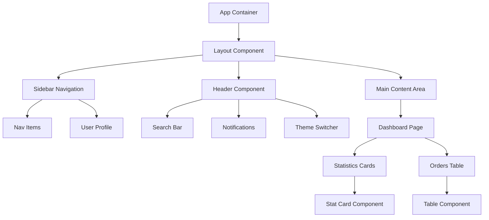

# Design Document: Order Management Dashboard UI

## Overview

The Order Management Dashboard is a responsive React-based web application that enables restaurant staff to view, track, and manage incoming orders in real-time. The dashboard provides a comprehensive overview of order statistics, incoming orders, menu management, payments, and analytics. The UI implements a modern design system with full light/dark theme support, accessibility compliance, and responsive layouts for desktop, tablet, and mobile devices.

## Architecture



## Design System

### Color Palette

#### Light Mode
- **Primary**: #2563EB (Blue-600) - Primary action and highlights
- **Secondary**: #7C3AED (Violet-600) - Secondary actions
- **Success**: #16A34A (Green-600) - Success states, active orders
- **Warning**: #EA580C (Orange-600) - Pending states
- **Danger**: #DC2626 (Red-600) - Error states, cancelled orders
- **Background**: #FFFFFF (White) - Primary background
- **Surface**: #F9FAFB (Gray-50) - Card and secondary backgrounds
- **Text Primary**: #111827 (Gray-900) - Main text
- **Text Secondary**: #6B7280 (Gray-500) - Secondary text
- **Border**: #E5E7EB (Gray-200) - Borders and dividers
- **Hover**: #F3F4F6 (Gray-100) - Hover states

#### Dark Mode
- **Primary**: #3B82F6 (Blue-500) - Primary action and highlights
- **Secondary**: #8B5CF6 (Violet-500) - Secondary actions
- **Success**: #22C55E (Green-500) - Success states
- **Warning**: #F97316 (Orange-500) - Pending states
- **Danger**: #EF4444 (Red-500) - Error states
- **Background**: #0F172A (Slate-900) - Primary background
- **Surface**: #1E293B (Slate-800) - Card and secondary backgrounds
- **Text Primary**: #F1F5F9 (Slate-100) - Main text
- **Text Secondary**: #94A3B8 (Slate-400) - Secondary text
- **Border**: #334155 (Slate-700) - Borders and dividers
- **Hover**: #1E293B (Slate-800) - Hover states

### Typography

- **Font Family**: Inter, -apple-system, BlinkMacSystemFont, "Segoe UI", sans-serif
- **H1**: 32px / 1.2 / bold (600) - Page titles
- **H2**: 24px / 1.3 / bold (600) - Section headers
- **H3**: 20px / 1.4 / semibold (600) - Subsection headers
- **Body**: 14px / 1.5 / normal (400) - Main content
- **Caption**: 12px / 1.5 / normal (400) - Labels, hints
- **Button Text**: 14px / 1.5 / medium (500) - Button labels

### Spacing System

- **xs**: 4px
- **sm**: 8px
- **md**: 16px
- **lg**: 24px
- **xl**: 32px
- **2xl**: 48px

### Component Specifications

## Layout Component

The main layout is a flexbox-based container that organizes the dashboard into header, sidebar, and main content regions.

**Structure**:
```
┌─────────────────────────────────────────┐
│           Header (h: 64px)              │
├──────────────┬──────────────────────────┤
│              │                          │
│   Sidebar    │    Main Content          │
│   (w: 240px) │     (flex: 1)            │
│              │                          │
│              │                          │
└──────────────┴──────────────────────────┘
```

**Specifications**:
- Header height: 64px
- Sidebar width: 240px (collapses to 60px on mobile)
- Main content: flex-grow-1 with padding 24px
- Z-index hierarchy: Header (100), Sidebar (90), Content (1)

## Sidebar Component

Navigation menu with collapsible sections and user profile area.

**Features**:
- Logo/brand area at top (48px height)
- Navigation items with icons and labels
- Active state indicator (left border, highlight)
- User profile card at bottom with avatar and tenant info
- Collapsible on mobile (hamburger menu trigger)
- Dark scrollbar in both themes

**Navigation Items**: Dashboard, Orders, Menu Management, Payments, Analytics/Reports, Settings, Support

**Mobile Behavior**:
- Slides in from left when menu is open
- Overlay backdrop when open
- Close button (X) at top right

## Header Component

Top navigation bar with search, notifications, integrations, and theme switcher.

**Layout**:
- Left side: Search bar (flex: 1, max-width: 400px)
- Center: Empty or future content
- Right side: Notifications button, Integration button, Theme switcher, User menu

**Search Bar**:
- Placeholder: "Search orders, customers, items..."
- Debounce: 300ms
- Results shown in dropdown
- Keyboard shortcut: Cmd/Ctrl + K

**Notifications Button**:
- Bell icon
- Badge showing count (background: danger color)
- Dropdown menu with recent notifications

**Integration Button**:
- Icon: link chain
- Opens integration panel

**Theme Switcher**:
- Toggle button with sun/moon icons
- Position: Right of integration button
- Persists selection to localStorage
- Smooth transition between themes (300ms)

**User Menu**:
- Avatar image
- Dropdown with Profile, Settings, Logout options

## Main Content Area

Dashboard page displaying order statistics and incoming orders.

**Layout**:
- Top row: 4 statistic cards (responsive grid)
- Bottom row: Incoming orders table

**Statistic Cards** (4-column grid on desktop, 2-column on tablet, 1-column on mobile):
1. Total Orders - #54 (primary color)
2. New Orders - #54 (warning color)
3. Preparing - #12 (info color)
4. Ready for Pickup - #09 (success color)

**Each Card**:
- Title (caption style)
- Large number (H1 style)
- Icon (24px)
- Background: surface color
- Border: 1px border
- Border radius: 8px
- Padding: 16px
- Hover: background shifts to hover state

## Orders Table Component

Displays incoming orders with sortable columns and action buttons.

**Columns**:
1. Order ID (text, left-aligned)
2. Customer Name (text, left-aligned)
3. Items Ordered (text, left-aligned, truncate with ellipsis)
4. Delivery ETA (text, center-aligned)
5. Status (badge component)
6. Action (button group)

**Status Badges**:
- Pending: Orange background
- Preparing: Blue background
- Ready: Green background
- Cancelled: Red background

**Action Buttons**:
- View Details (icon: eye)
- Update Status (icon: pencil)
- Cancel (icon: trash)

**Table Features**:
- Sortable headers (click to sort)
- Pagination (10 rows per page)
- Zebra striping (alternate row colors)
- Hover effect on rows (highlight row background)
- Empty state message when no orders
- Loading skeleton when fetching

**Responsive**:
- Desktop (1200px+): Full table
- Tablet (768px-1199px): Hide "Items Ordered", show in detail modal
- Mobile (< 768px): Show card view instead of table

## Theme Switcher Component

Dedicated toggle button for switching between light and dark modes.

**Visual Design**:
- Toggle button (48px height, 48px width)
- Sun icon (light mode)
- Moon icon (dark mode)
- Smooth rotation animation on click (200ms)
- Tooltip: "Switch to dark mode" / "Switch to light mode"
- No visible state change on button itself (theme changes globally)

**Implementation**:
- Uses CSS custom properties (CSS variables) for theming
- Theme state stored in localStorage with key: "dashboard-theme"
- Reads system preference on first visit (prefers-color-scheme media query)
- Applies theme to document root element

**Behavior**:
- On click: Toggle theme
- On page load: Restore from localStorage or detect system preference
- Smooth transition (300ms) using CSS transitions on color properties

## Accessibility Requirements

### WCAG 2.1 Level AA Compliance

**Keyboard Navigation**:
- All interactive elements focusable (tabindex appropriately set)
- Focus visible indicator (2px outline)
- Tab order follows logical flow
- Escape key closes modals/dropdowns
- Arrow keys navigate table rows and select items

**Screen Reader Support**:
- Semantic HTML (button, nav, header, main, article)
- aria-labels for icon-only buttons
- aria-current="page" for active nav item
- aria-live regions for notifications
- aria-hidden for decorative elements
- Table headers marked with scope="col"
- Form inputs have associated labels (htmlFor)

**Color Contrast**:
- All text has minimum 4.5:1 contrast ratio (normal text)
- Minimum 3:1 contrast ratio (large text 18pt+)
- Status badges have text contrast, not relying on color alone
- Icons paired with text labels

**Focus Management**:
- Modal opens: focus moves to modal content
- Modal closes: focus returns to trigger element
- Dropdown opens: focus moves to first item
- Alert messages: announced to screen readers

**Responsive Text**:
- Base font size: 14px (accessible default)
- Supports up to 200% zoom without horizontal scroll
- Line spacing: minimum 1.5x
- Paragraph spacing: minimum 2x font size

## Responsive Design

### Breakpoints

- **Mobile**: < 640px (max-width: 639px)
- **Tablet**: 640px - 1023px
- **Desktop**: >= 1024px

### Layout Adjustments

**Mobile (< 640px)**:
- Sidebar: Collapsible hamburger menu (overlay)
- Header: Compact with smaller font sizes
- Statistics cards: 1-column grid, full width
- Orders table: Card-based layout instead of table
- Main padding: 12px
- Font sizes reduced by ~10%

**Tablet (640px - 1023px)**:
- Sidebar: Collapsible to icons-only (60px width)
- Statistics cards: 2-column grid
- Orders table: Hide less important columns, show in modal
- Main padding: 16px
- Full-size fonts retained

**Desktop (>= 1024px)**:
- Sidebar: Full width (240px), always visible
- Statistics cards: 4-column grid
- Orders table: Full table view
- Main padding: 24px
- All content visible

### Image Scaling

- Avatar images: 40px (header), 56px (sidebar profile)
- Icons: 20px (nav), 24px (table actions)
- SVG icons: scale smoothly, no pixel artifacts

## Technical Architecture

### Component Hierarchy

```
<App>
  <ThemeProvider theme={theme}>
    <Layout>
      <Header 
        onThemeToggle={toggleTheme}
        currentTheme={theme}
      />
      <Sidebar activeRoute={activeRoute} />
      <MainContent>
        <DashboardPage>
          <StatisticsGrid>
            <StatCard icon={} label={} value={} />
            ...
          </StatisticsGrid>
          <OrdersTable orders={orders} />
        </DashboardPage>
      </MainContent>
    </Layout>
  </ThemeProvider>
</App>
```

### State Management

- **Theme State**: React Context (ThemeContext) with localStorage persistence
- **UI State**: useState for modals, dropdowns, sidebar collapse
- **Data State**: API integration for orders, statistics
- **Route State**: React Router for navigation

### Styling Approach

**CSS-in-JS with Tailwind CSS**:
- Utility-first approach for rapid component styling
- Dark mode class strategy (`dark:` prefix)
- Custom theme colors in tailwind.config.js
- CSS custom properties for dynamic theme switching

**Tailwind Configuration**:
```javascript
module.exports = {
  darkMode: 'class',
  theme: {
    colors: {
      // Custom color palette
      primary: {
        50: '...',
        900: '...',
      },
      // Other colors...
    },
    spacing: {
      xs: '4px',
      sm: '8px',
      md: '16px',
      lg: '24px',
      xl: '32px',
      '2xl': '48px',
    },
  },
  plugins: [
    // Custom plugins for theme variables
  ],
}
```

### Theme Implementation

**CSS Variables Approach**:
```css
:root {
  --color-primary: #2563EB;
  --color-surface: #FFFFFF;
  /* ... other variables ... */
}

[data-theme="dark"] {
  --color-primary: #3B82F6;
  --color-surface: #1E293B;
  /* ... other dark mode variables ... */
}
```

**React Context for Theme**:
- ThemeContext provides current theme and toggle function
- All components consume via useTheme hook
- localStorage syncs theme across tabs/sessions
- System preference detected on initial load

## Correctness Properties

*A property is a characteristic or behavior that should hold true across all valid executions of a system—essentially, a formal statement about what the system should do. Properties serve as the bridge between human-readable specifications and machine-verifiable correctness guarantees.*

### Property 1: Theme Persistence

*For any* theme selection (light or dark), storing the theme preference and reloading the page should restore the same theme without flickering or layout shift.

**Validates: Requirements 3.1, 3.2**

### Property 2: Theme Coverage

*For all* UI components and pages, switching theme should apply consistently across the entire application—no components should remain in the previous theme.

**Validates: Requirements 3.3, 3.4**

### Property 3: Accessibility Preservation

*For any* theme mode (light or dark), all interactive elements should remain keyboard accessible and screen reader compatible regardless of theme state.

**Validates: Requirements 4.1, 4.2, 4.3, 4.4**

### Property 4: Responsive Breakpoint Correctness

*For any* viewport width, the layout should render the correct configuration (mobile card view < 640px, tablet grid 640-1023px, desktop full layout >= 1024px).

**Validates: Requirements 5.1, 5.2, 5.3**

### Property 5: Color Contrast Compliance

*For all* text content and interactive elements, the contrast ratio should meet WCAG AA standards (minimum 4.5:1 for normal text, 3:1 for large text) in both light and dark modes.

**Validates: Requirements 4.5, 4.6**

