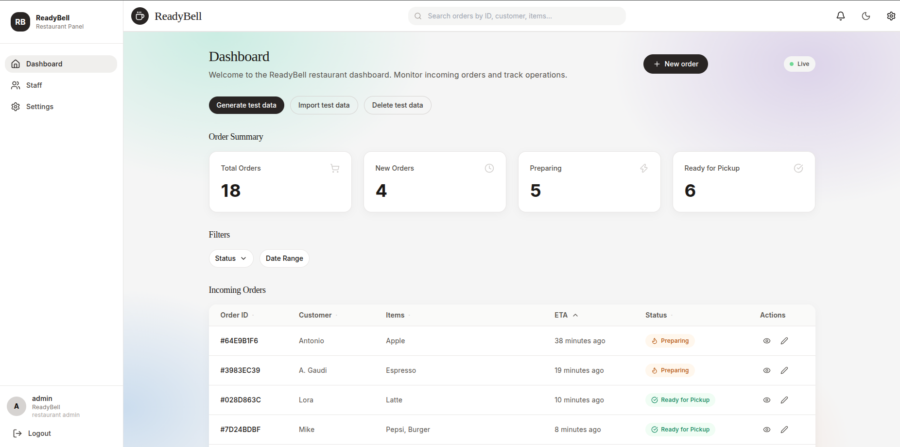
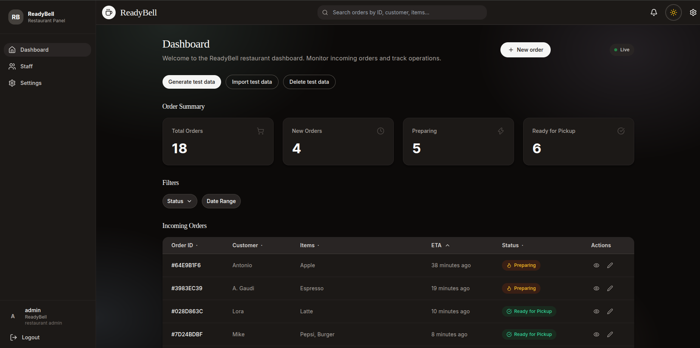
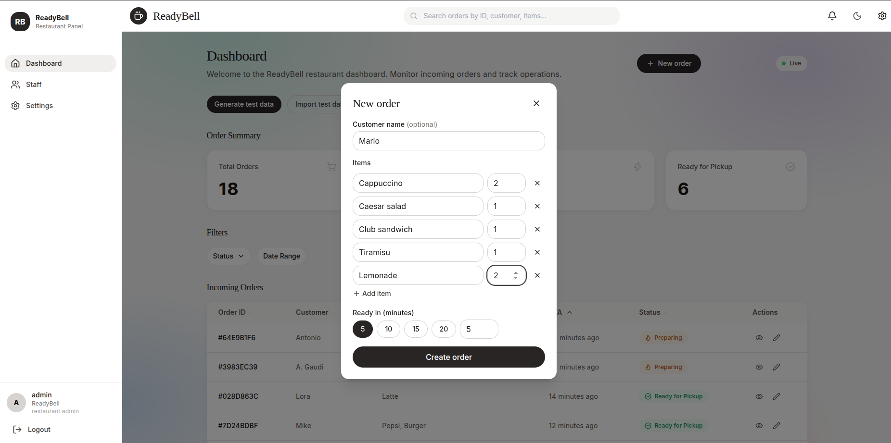
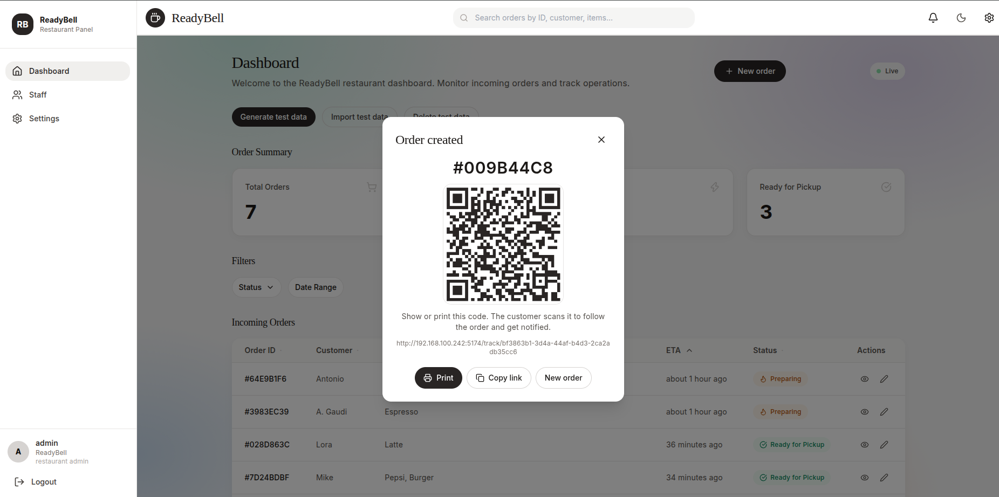
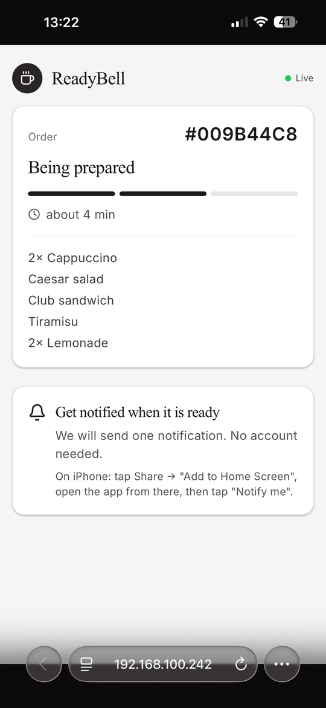
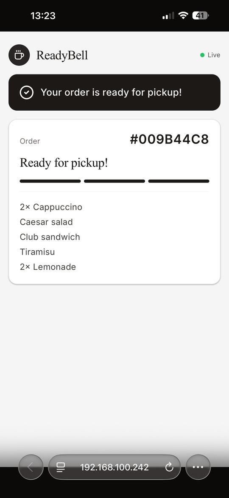

# ReadyBell

ReadyBell is a multi-tenant SaaS platform that lets restaurant customers track their order status and get notified the moment their order is ready — without installing a native app or creating an account. A customer scans a table or counter QR code to start a session, opens a mobile-first Progressive Web App (PWA), and optionally opts in to Web Push notifications. Restaurant staff manage order status through a web panel, restaurant admins manage staff and configuration, and a platform admin onboards and manages restaurants (tenants) across the whole system.

## Key Features

- **QR-based session start (no login required)** — Scanning a QR code resolves to a restaurant and starts a `CustomerSession` with no credentials, giving each scan a distinct session identity tied to that restaurant's tenant.
- **PWA customer interface with order tracking** — A mobile-first web app (installable, served over HTTPS) shows the live state of every order tied to the customer's session, with a clear empty state when there are no orders yet.
- **Web Push notifications via VAPID when order is ready** — When an order transitions to `READY`, the platform delivers a Web Push message to every registered device subscription for that session, authenticated with VAPID keys, through a swappable `NotificationSender` port.
- **Order lifecycle management** — Orders move through a strict state machine: `CREATED → IN_PROGRESS → READY → COMPLETED`, with `CANCELLED` reachable from any non-terminal state. Invalid, self, or post-terminal transitions are rejected, and concurrent transition attempts are resolved so exactly one succeeds (optimistic locking).
- **Restaurant staff panel (order management)** — Authenticated staff create orders against a customer session and drive orders through their lifecycle, scoped strictly to their own restaurant's data.
- **Restaurant admin (staff account + config management)** — Restaurant admins create, update, and deactivate staff accounts and manage restaurant configuration, all scoped to their own tenant.
- **Platform admin (multi-tenant restaurant management)** — A platform admin creates, updates, and deactivates restaurants (tenants) across the entire platform; deactivated restaurants reject new customer sessions.
- **Strict multi-tenant data isolation** — Every tenant-scoped table carries a `tenant_id`, enforced at the query layer by a Hibernate `@Filter` bound to the request's resolved `TenantId`, so cross-tenant records are never returned, modified, or leaked.
- **Event-driven architecture** — Domain events (`CustomerSessionStarted`, `OrderCreated`, `OrderStatusUpdated`, `OrderReady`, `NotificationSent`, `NotificationDelivered`) are published in-process through a `DomainEventPublisher` port, so the domain has zero knowledge of the messaging mechanism and it can be swapped for an external broker later without touching domain code.
- **Real-time updates via SSE with polling fallback** — Order status changes are pushed to open clients over Server-Sent Events (customer and staff-panel streams), with a one-shot polling endpoint as a fallback when a persistent connection isn't available.
- **Horizontal scalability** — The application runs as stateless replicas behind a load balancer, with session/cache state externalized to Redis so any replica can serve any request.

## Screenshots

**Staff dashboard, light theme.** Live order summary (total, new, preparing, ready for pickup), status and date
filters, and the incoming-orders table where staff move an order through its lifecycle. **New order** opens the
order entry dialog and prints the receipt QR code that customers scan to follow their order. The
*Generate / Import / Delete test data* buttons only appear in development builds.



**The same dashboard in the dark theme.** The theme toggle in the header switches between them and the choice is
remembered per browser.



**Entering an order.** Staff press **New order**, type the customer's name (optional), the items with their
quantities and how many minutes until it is ready, then **Create order**. No customer session is needed up front: the
server starts one together with the order.



**Receipt QR code.** Right after creation the dialog shows the order number and a QR code that links to the
customer's tracking page (`/track/<session>`). Staff can print it on the receipt or copy the link; the customer scans
it to see the live status and get a notification when the order is ready. No app and no account are needed.



**Customer tracking page (phone).** Opened from the receipt QR code, with no app and no sign-in. It shows the
restaurant, the order number, the current step (received, being prepared, ready), the estimated wait and the items,
and updates live. While the order is not ready it offers **Notify me** (Web Push); on iPhone the page first has to be
added to the Home Screen, as the hint explains. When staff mark the order ready, the banner and the full progress bar
appear at once.

<table>
  <tr>
    <td align="center"><br><sub>Being prepared</sub></td>
    <td align="center"><br><sub>Ready for pickup</sub></td>
  </tr>
</table>

## Architecture

ReadyBell is built domain-first using Domain-Driven Design and Clean/Hexagonal (Ports & Adapters) architecture, packaged as a single deployable **modular monolith**. The domain layer has no framework dependencies; application services orchestrate use cases against ports; adapters (REST controllers, JPA repositories, Redis, Web Push, Spring's event publisher) implement those ports and are wired by Spring configuration. Dependencies point inward — nothing in the domain depends on an adapter.

Each bounded context is its own top-level package with the same internal shape (`domain` / `application` / `adapter.in` / `adapter.out`):

- **`shared`** — shared kernel: `TenantId`, `DomainEvent`, tenancy primitives used by every context.
- **`session`** — the Session bounded context: the `CustomerSession` aggregate, QR-based session start.
- **`ordering`** — the Ordering bounded context: the `Order` aggregate and its lifecycle state machine.
- **`subscription`** — the Subscription bounded context: the `DeviceSubscription` aggregate and Web Push endpoint storage.
- **`restaurant`** — the Restaurant/Tenant context: `Restaurant` and `StaffAccount` aggregates, staff/admin management.
- **`notification`** — the Notification bounded context: composing and delivering notifications through the `NotificationSender` port.
- **`platformadmin`** — cross-tenant tenant management for the platform admin.
- **`platform`** — the composition root: Spring configuration, security, the tenant-resolution filter, and the in-process event publisher adapter.

Contexts integrate only through domain events published via the event port or through published application-service interfaces — never by reaching directly into another context's aggregates or tables.

## Tech Stack

| Concern | Choice |
| --- | --- |
| Language / runtime | Java 21 |
| Application framework | Spring Boot 3.4 (Web, Validation, Security) |
| Persistence | Spring Data JPA + Hibernate, PostgreSQL |
| In-process events | Spring `ApplicationEventPublisher` behind a `DomainEventPublisher` port |
| Cache / session store | Redis (Spring Data Redis) |
| Web Push | VAPID via `web-push` (BouncyCastle for EC crypto), behind a `NotificationSender` port |
| Testing | JUnit 5, jqwik (property-based testing), Spring Security Test, H2 (test profile) |

## Getting Started

### Prerequisites

- Java 21
- PostgreSQL reachable at the connection details in `src/main/resources/application.yml` (defaults to `jdbc:postgresql://localhost:5432/readybell`)
- Redis reachable at the connection details in `application.yml` (defaults to `localhost:6379`)

A `docker-compose.yml` runs the whole stack (app + PostgreSQL + Redis): see [docs/DEPLOYMENT.md](docs/DEPLOYMENT.md). For local development, point the `spring.datasource` and `spring.data.redis` settings in `application.yml` at your own PostgreSQL/Redis instances, or use the `dev` profile.

### Build

```bash
./gradlew build
```

### Run tests

```bash
./gradlew test
```

### Run the app

```bash
SPRING_PROFILES_ACTIVE=dev ./gradlew bootRun
```

The application reads VAPID keys from environment variables (they fall back to placeholder values if unset, which will not work with real browser push services):

```bash
export VAPID_PUBLIC_KEY=<your-vapid-public-key>
export VAPID_PRIVATE_KEY=<your-vapid-private-key>
```

## API Overview

Customer-facing endpoints are unauthenticated but scoped to a session; staff, admin, and platform-admin endpoints require authentication (HTTP Basic for the current MVP) and are tenant-scoped.

### Customer Session API (public)

| Method | Path | Description |
| --- | --- | --- |
| `POST` | `/api/sessions` | Start a customer session from a scanned QR token |
| `GET` | `/api/sessions/{id}/orders` | List orders and current states for a session |
| `GET` | `/api/sessions/{sessionId}/orders/poll` | Poll for the current order snapshot (SSE fallback) |
| `GET` | `/api/sessions/{sessionId}/orders/stream` | Server-Sent Events stream of order status updates for a session |

### Subscription API (public, session-scoped)

| Method | Path | Description |
| --- | --- | --- |
| `POST` | `/api/sessions/{sessionId}/subscriptions` | Register a new Web Push subscription, or update keys for an existing endpoint |
| `DELETE` | `/api/sessions/{sessionId}/subscriptions/{subscriptionId}` | Revoke a device subscription |

### Order Management API (staff auth, tenant-scoped)

| Method | Path | Description |
| --- | --- | --- |
| `POST` | `/api/login`, `/api/auth/refresh` | Public: exchange credentials / an old token for a Bearer JWT (failed logins are throttled → 429) |
| `POST` | `/api/orders` | Create an order for a customer session, with optional `customerName`, `items[{name,quantity}]`, `estimatedMinutes` |
| `GET` | `/api/orders` | Paginated list: `page`, `pageSize` (≤100), `status` (repeatable/comma), `sortBy` (`created`,`eta`,`status`,`customerName`,`orderId`), `sortOrder`, `search` |
| `GET` | `/api/orders/poll` | Polling fallback: orders changed `since` an instant, with `ETag` (304 if unchanged) |
| `PATCH` | `/api/orders/{id}/status` | Transition an order to a new lifecycle status |
| `GET` | `/api/orders/stream` | Server-Sent Events stream of order status updates for the tenant |

### Restaurant Admin API (admin auth, tenant-scoped)

| Method | Path | Description |
| --- | --- | --- |
| `POST` | `/api/admin/staff` | Create a staff account |
| `DELETE` | `/api/admin/staff/{accountId}` | Deactivate a staff account |
| `PUT` | `/api/admin/config` | Update restaurant configuration |

### Platform Admin API (platform-admin auth, cross-tenant)

| Method | Path | Description |
| --- | --- | --- |
| `POST` | `/api/platform/restaurants` | Create a new restaurant tenant |
| `PUT` | `/api/platform/restaurants/{tenantId}` | Update a restaurant's configuration |
| `DELETE` | `/api/platform/restaurants/{tenantId}` | Deactivate a restaurant |

## Testing

Domain and application logic is covered by JUnit 5 unit tests co-located under `src/test/java`, alongside jqwik for property-based testing. Correctness properties are defined in the [design document](.kiro/specs/restaurant-notification-platform/design.md) and each covers a specific behavioral guarantee derived from the requirements — for example, that session start always assigns the correct tenant and produces a distinct session identity, that invalid or incomplete subscription registrations are rejected without storing partial data, that order transitions only follow the allowed lifecycle graph, and that revoked or invalid subscriptions never receive further notifications. Each property-based test is tagged with the feature name and the property it validates, and is run for a minimum of 100 iterations.

## Documentation

- [docs/DEVELOPMENT.md](docs/DEVELOPMENT.md) — local setup, running, testing, troubleshooting
- [docs/API_INTEGRATION.md](docs/API_INTEGRATION.md) — dashboard ↔ backend endpoints, auth, errors
- [docs/UI_QUALITY.md](docs/UI_QUALITY.md) — accessibility, contrast, responsive and performance reference
- [docs/PROGRESS.md](docs/PROGRESS.md) — completed tasks and results
- `docs/architecture`, `docs/product`, `docs/brand` — design and product docs; `.kiro/specs` — feature specs
