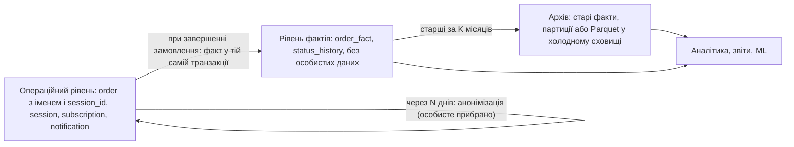

# Зберігання, архівація і видалення даних: аналіз і план (GDPR, аналітика)

Дата: 2026-11-18. Стан коду: `master` після PR #55.

> Це технічний аналіз, а не юридична консультація. Терміни зберігання нижче це пропозиції для узгодження з юристом і продуктом.
> GDPR діє, якщо серед клієнтів є особи в ЄС або серед ресторанів є ресторани в ЄС (стаття 3). Закон України «Про захист
> персональних даних» ґрунтується на тих самих принципах. Правова оцінка і шаблони документів (політика конфіденційності,
> договір обробки) потребують юриста.

## 1. Висновок коротко

1. **Основа вже хороша.** Клієнт анонімний (немає акаунта), сесія це непідбираний UUID, push-підписки видаляються після завершення
   сесії, outbox чиститься за 7 днів, у логах немає імен (лише префікс сесії і хост push-сервісу). Це принцип мінімізації, і його
   треба зберегти й зробити правилом.
2. **Головна прогалина: замовлення зберігаються вічно разом з особистими полями.** `order.customer_name` і назви позицій
   (`order_item.name`, вільний текст) нікуди не зникають, хоч клієнт чекає хвилини. Те саме з текстами в `notification` і з
   акаунтами персоналу, що лише деактивуються. Немає також видалення за запитом, експорту даних, відомостей про згоду на push і
   процедури виходу ресторану з платформи.
3. **Рекомендований підхід: три рівні даних і «факти без особистих даних».**
   - **Операційний рівень** (гарячий, містить особисті дані, зберігається коротко): замовлення з іменем, сесії, підписки.
   - **Рівень фактів** (без особистих даних, зберігається довго): що, коли і скільки, без імені, без посилання на людину.
     Це і є база для аналітики.
   - **Архів** (холодний): старі факти, які не потрібні в гарячій БД, в окремому сховищі, теж без особистих даних.

   Видалення особистого не знищує історію бізнесу: з замовлення прибирається особисте, а факт лишається.
4. **Аналітика й GDPR не конфліктують, якщо факти справді анонімні.** Для цього потрібне прибирання посилання на сесію,
   вільного тексту й дрібних груп. Просто зняти `customer_name` недостатньо (розділ 6). Для лояльності, де клієнт ідентифікований,
   використовуємо псевдонім із ключем на ресторан: видалення ключа робить історію неможливою для зв'язування.
5. **Порядок:** спершу документи й рішення (Фаза 0), потім фонові задачі зберігання (Фаза 1), права суб'єкта даних (Фаза 2),
   потім факти для аналітики й архів (Фаза 3). Факти мають з'явитися **до** того, як запрацює анонімізація, інакше історію не відновити.

## 2. Ролі

| Хто | Роль | Наслідок |
|---|---|---|
| Ресторан | **володілець** (controller) даних своїх клієнтів і працівників | визначає строки, відповідає на запити клієнтів, інформує клієнтів |
| ReadyBell | **обробник** (processor) цих даних; для даних самого ресторану як клієнта (контакти адміна, оператор) сам володілець | договір обробки (DPA) з рестораном, перелік субобробників, інструменти для запитів |
| Push-сервіси (Google, Apple, Mozilla, Microsoft) | субобробники | знають endpoint пристрою, передача поза ЄС потребує механізму передачі (стандартні договірні положення) |
| Хостинг, резервні копії | субобробники | договір і шифрування |

Практично: **запит клієнта** («видаліть мої дані») надходить до ресторану, а ReadyBell надає ресторану (і самому клієнту, бо
облікового запису в нього немає) кнопку, яка це виконує.

## 3. Інвентар даних

Клас: **P1** прямий ідентифікатор, **P2** псевдонім (прив'язується до людини з додатковою інформацією), **P3** не особисті.

| Де | Дані | Клас | Зараз | Пропозиція |
|---|---|---|---|---|
| `order.customer_name` | ім'я клієнта, вільний текст до 100 символів | **P1** | вічно | прибирати через N днів (за замовчуванням 30), у формі підказка «ім'я чи ініціали, не обов'язково» |
| `order_item.name` | назви позицій, вільний текст | P2/P1 (можуть містити імена: «латте для Анни») | вічно | деталь через N днів; для аналітики нормалізований ключ позиції (довідник меню, AN-02) |
| `order` (id, `session_id`, час, статус, `connected_at`) | ідентифікатори й час | P2 (`session_id` зв'язує замовлення з пристроєм) | вічно | `session_id` розірвати через N днів; решта в факт |
| `customer_session` | UUID, статус, час | P2 (UUID це ключ до сторінки, фактично ідентифікатор) | `ENDED` після 24 год, рядки лишаються | видаляти рядки завершених сесій через 30 днів |
| `device_subscription` | `endpoint_url`, `p256dh_key`, `auth_key` | **P1/P2** (endpoint ідентифікує пристрій) | видаляється при завершенні сесії, при `404/410` | лишити; додати `consent_at` і версію повідомлення |
| `notification` | текст («Order #12 is ready»), статус, час | P2 | вічно | текст прибирати через 30 днів, статус і час лишити 90 днів, далі в агрегат |
| `outbox_event.payload` | id і номер замовлення | P2 | 7 днів | як є; контракт подій забороняє особисті дані |
| `staff_account` | `username`, `password_hash`, статус | **P1** (ім'я може бути справжнім) | деактивований лишається назавжди | після видалення чи N днів після деактивації: ім'я замінити на `deleted-<id>`, хеш обнулити |
| `restaurant` | `identifier`, `config_json` (назва) | P3 (дані бізнесу) | вічно | за договором, після виходу ресторану за графіком у розділі 5.5 |
| Redis | ключі лічильників входу (ім'я + IP), ліміти (IP, сесія), відкликані `sid`/`jti`, тікети SSE | P1/P2 (IP це особисті дані) | лише TTL | лишити; перелік TTL у документації |
| Логи застосунку | префікс сесії (8 символів), хост push-сервісу, помилки | P2 | не обмежено | 30 днів; перевірка, що імен і endpoint немає |
| Логи проксі | IP, шлях | P1/P2 | залежить від проксі | 7 днів або скорочувати IP (остання частина) |
| Резервні копії (`pg_dump`) | усе вище | P1/P2 | 14 днів (локально) | політика в розділі 5.6 |
| Браузер | токен персоналу і ресторан у `localStorage` | P2 | до виходу | лишити; це суворо необхідне для роботи |

Висновок з інвентаря: особисті дані зосереджені в кількох колонках (`customer_name`, `order_item.name`, `session_id`,
endpoint, `username`). Це зручно: видалення стає «обнулити ці поля», а не «шукати по всій базі».

## 4. Принципи → що саме це означає в коді

| Принцип GDPR | Вимога | Рішення |
|---|---|---|
| Мінімізація (5.1.c) | не збирати зайве | ім'я необов'язкове і з підказкою; нові події без особистих даних; дані клієнта лише ті, що потрібні |
| Обмеження зберігання (5.1.e) | не тримати довше, ніж потрібно | автоматичні задачі (розділ 5.2) за розкладом, а не «колись почистимо» |
| Обмеження мети (5.1.b) | аналітика окремо від обслуговування | факти без особистих даних (розділ 6); для лояльності окрема згода і окрема таблиця |
| Видалення (17) | «забути» на вимогу без зайвої затримки | кнопка для клієнта, інструмент для адміна, журнал виконання (розділ 5.3) |
| Доступ (15) і перенесення (20) | дати копію даних | експорт замовлень сесії в JSON; експорт даних ресторану при виході |
| Заперечення (21), відкликання згоди (7.3) | зупинити обробку | відписка від push видаляє підписку; згода зберігається з версією |
| Захист за замовчуванням (25) | суворі налаштування «з коробки» | короткі строки за замовчуванням, межі для ресторану (мін/макс) |
| Безпека (32) | захист даних | шифрування резервних копій, доступ за ролями, журнал дій оператора |
| Облік обробки (30) | реєстр | документ із розділу 3, підтримується разом із кодом |
| Повідомлення про порушення (33) | 72 години | runbook інциденту |
| Передача за кордон (44+) | push-сервіси поза ЄС | перелік субобробників і правова основа передачі в політиці |

## 5. Логіка зберігання, архівації і видалення

### 5.1 Модель даних у рівнях

Правило: **факт записується в момент завершення чи скасування замовлення, в одній транзакції зі зміною статусу**. Тоді
анонімізацію гарячого запису можна робити в будь-який час без втрати історії.

### 5.2 Задачі зберігання (retention jobs)

Один каркас, за зразком `SessionHousekeeping` (планувальник, advisory lock на PostgreSQL, один вузол за раз):

| Задача | Умова | Дія |
|---|---|---|
| `anonymizeOrders` | замовлення завершене чи скасоване, старше N днів (за замовчуванням 30, межі 7–365) | `customer_name = NULL`, назви позицій узагальнити (розділ 6), `session_id` замінити на випадковий UUID без зв'язку, нічого не видаляти з фактів |
| `purgeSessions` | сесія `ENDED` понад 30 днів, замовлень з її UUID вже немає | видалити рядок |
| `scrubNotifications` | старші за 30 днів | `payload` замінити порожнім, статус і час лишити; через 90 днів видалити або звести в лічильник |
| `anonymizeStaff` | акаунт видалено, або `DEACTIVATED` понад 30 днів | `username = deleted-<id>`, `password_hash = NULL` |
| `purgeTenant` | ресторан у стані `PENDING_DELETION` понад грейс-період | видалити всі рядки tenant (порядок у 5.5) |
| `rollFacts` | факти старші за K місяців | перенести в архів (5.4) |

Вимоги до кожної задачі: **ідемпотентна** (повторний запуск нічого не псує), **пакетна** (по 500-1000 рядків, не блокує БД),
**з режимом dry-run** (лише рахує), **з метриками** (`retention_rows_total{task,action}`, `retention_last_success_timestamp`,
алерт на «не запускалась понад 2 доби»), **з журналом запуску** (`retention_run`: початок, кінець, лічильники, помилка).
Порядок задач у добовому циклі: спершу переконатися, що факти записані, потім анонімізувати, потім чистити сесії.

Важливо: зовнішніх ключів майже немає (одна FK `order_item → order`), тож порядок видалення задає код, а не БД.
Це треба покрити тестом (розділ 9).

### 5.3 Права суб'єкта даних

**Клієнт без акаунта.** Його «автентифікація» це володіння посиланням на замовлення (UUID сесії), як і для сторінки стеження.
Сторінка клієнта отримує два пункти:
- **«Видалити мої дані»**: видаляє push-підписки сесії, анонімізує замовлення цієї сесії (ім'я, позиції в узагальнений вигляд,
  розрив посилання на сесію). Дію може виконати будь-хто, хто має посилання. Це прийнятно: шкода мінімальна, а посилання і так є ключем.
- **«Завантажити мої дані»**: JSON із замовленнями сесії (номер, час, позиції, статуси) і відомостями про підписки (без ключів).

**Ресторан (за запитом клієнта, що прийшов на касу).** Адмін ресторану може знайти замовлення за номером і виконати ті самі дії
(«стерти особисті дані замовлення», «експортувати»). Видалення за іменем шукає лише в межах tenant.

**Працівник.** Адмін ресторану видаляє акаунт (зараз лише деактивація): особисті поля обнуляються за 5.2 негайно, не чекаючи тридцяти днів.

**Ресторан.** Вихід з платформи (5.5).

**Журнал видалення `erasure_log`** (без особистих даних): `id`, `tenant_id`, тип суб'єкта, хеш посилання (`HMAC`, не сам UUID),
обсяг, час запиту, час виконання, ким. Навіщо: (1) довести виконання; (2) **повторити видалення після відновлення з резервної
копії** (розділ 5.6); (3) розіслати подію про видалення в інші системи (аналітичне сховище, брокер).

**Строки:** відповідь на запит у межах місяця (стаття 12); для самообслуговування, яке виконується одразу, це секунди.

### 5.4 Архів

«Архів» тут не про «покласти старе на склад», а про дві вимоги: гаряча БД лишається малою й швидкою, а історія доступна для аналітики.

| Варіант | Суть | Плюси | Мінуси | Коли |
|---|---|---|---|---|
| **A. Таблиця фактів + видалення з `order`** (рекомендація для старту) | `order_fact` пишеться при завершенні, а `order` анонімізується через N днів і лишається на невелику кількість місяців, далі видаляється | просто, без нової інфраструктури, природний «архів без особистих даних» | `order_fact` росте, але рядок малий (десятки байт) | пілот і сотні ресторанів |
| B. Партиціювання за місяцем | `order_fact` і `status_history` партиціюються за `created_at`; старі партиції відчіплюються й стискаються | швидка чистка (відчепити партицію), швидкі запити за періодом | складніша міграція, ключі мають містити `created_at` | коли таблиця фактів сягне сотень мільйонів рядків |
| C. Експорт у холодне сховище (Parquet в об'єктному сховищі) | місячні файли без особистих даних | дешево, зручно для аналітики й ML | окремий пайплайн, потрібна схема | коли з'явиться окреме аналітичне сховище або ML |

Рекомендація: **A зараз, B за обсягом, C за потребою аналітики** (узгоджується з планом брокера і CDC у `KAFKA_PLAN.md`).

### 5.5 Вихід ресторану з платформи (tenant offboarding)

Стани ресторану: `ACTIVE` → `DEACTIVATED` (є) → **`PENDING_DELETION`** → `DELETED`.

1. `DEACTIVATED`: нові сесії відхиляються, персонал не входить (є). Ресторан може відновитися.
2. Запит на видалення: ресторан отримує **експорт** (замовлення, персонал, налаштування, JSON/CSV) за посиланням з обмеженим терміном.
3. `PENDING_DELETION`: грейс-період (30 днів) на передумування; усі особисті дані tenant вже анонімізовані за 5.2.
4. Видалення в такому порядку: `order_item` → `order` → `notification` → `device_subscription` → `customer_session` →
   `outbox_event` → `staff_account` → `restaurant`. Факти tenant: за договором або видаляються, або лишаються анонімними (рішення в розділі 8).
5. Запис у `erasure_log`; підтвердження ресторану.

### 5.6 Резервні копії

Видалити з резервних копій окремий рядок практично неможливо, тому **правило таке**: видалення з гарячої БД негайне, а з копій
**зникає саме з плином часу** (зараз 14 днів). Але потрібне доповнення:
- **при відновленні з копії спочатку повторити всі записи `erasure_log` за період копії**, і лише потім відкривати доступ (runbook);
- копії шифруються, доступ обмежений, копія поза хостом з тим самим або коротшим терміном;
- строк копій фіксується в політиці конфіденційності («дані зникають з копій протягом 14 днів»).

## 6. Анонімізація для аналітики: що це означає насправді

Прибрати `customer_name` недостатньо: «анонімні» дані, які можна зв'язати з людиною, лишаються особистими.

| Ризик | Приклад | Захист |
|---|---|---|
| Посилання на сесію | `session_id` у факті веде до сторінки й підписки | у факті немає `session_id` взагалі; у гарячому записі він замінюється випадковим UUID |
| Вільний текст | «латте для Анни» | у фактах лише ключ позиції з довідника меню (AN-02); до того, як довідник з'явиться, позиції у фактах не зберігаються поштучно, а лише кількість |
| Мала група | один клієнт у ресторані зранку | звіти приховують групи менше k (наприклад 5) |
| Час із точністю до секунди | можна зіставити з чеком | у фактах точний час лишається (потрібний для аналітики очікування), але разом з іншими ідентифікаторами його немає; для зовнішніх звітів час округлюється до години |
| Об'єднання з іншими даними | додаткова інформація в аналітичному сховищі | сховище без ключів повернення до гарячої БД |

**Псевдонімізація для лояльності.** Коли з'являється ідентичність клієнта (LY-02 у `KAFKA_PLAN.md`), у фактах зберігається
`customer_key = HMAC(ключ_ресторану, ідентифікатор)`. Це **псевдонім**, тобто особисті дані, і підпадає під GDPR (потрібна підстава:
згода чи договір, окрема політика строків, наприклад видалення після 24 місяців без візитів). Видалення ключа ресторану
(**crypto-shredding**) робить історію незв'язуваною: аналітика лишається, особу відновити не можна.

**Зв'язок з іншими планами.**
- Події (`domain_event`, брокер) **не містять особистих даних за контрактом**: лише посилання. Це правило KF-05 у `KAFKA_PLAN.md`.
- CDC (Debezium) публікує **лише колонки без особистих даних** (фільтр колонок у публікації) і передає видалення (tombstone).
- Подія `DataErased {tenant, scope, subjectRef}` доходить до аналітичного сховища, воно видаляє за `customer_key`.

## 7. Що змінюється в схемі (чернетка)

| Зміна | Навіщо |
|---|---|
| `order_fact(order_ref, tenant_id, created_at, in_progress_at, ready_at, completed_at, cancelled, item_count, connected, push_sent)` | довга історія без особистих даних |
| `order_status_history(order_ref, from, to, at, actor)` | час етапів (AN-01), актор це id акаунта, не ім'я |
| `order.session_id` залишається `NOT NULL`, при анонімізації отримує випадковий UUID | без міграції типу, але зв'язок розірвано |
| `order_item.name` стає допускати порожнє значення або зберігає узагальнене | можливість прибрати вільний текст |
| `device_subscription.consent_at`, `consent_notice_version` | доказ згоди на push |
| `erasure_log(id, tenant_id, subject_type, subject_ref_hmac, scope, requested_at, completed_at, performed_by)` | підтвердження і повтор після відновлення |
| `retention_run(id, task, started_at, finished_at, counts, error)` | прозорість і алерти |
| `restaurant.status` додає `PENDING_DELETION`, `deletion_scheduled_at` | вихід ресторану |
| `tenant_retention_settings(tenant_id, order_days, ...)` (пізніше) | налаштування ресторану в межах стелі платформи |

## 8. Рішення, які потрібні

| Питання | Варіанти | Рекомендація |
|---|---|---|
| Строк до анонімізації замовлення | 7 / 30 / 90 днів | 30 днів, межі 7–365 для ресторану |
| Чи зберігати факти після виходу ресторану | видаляти разом з рестораном; лишати анонімними | за договором; для анонімних фактів дозволити лишати, якщо це записано в договорі |
| Чи потрібен довідник меню і цін | так (AN-02); ні, лише кількість позицій | так: без нього аналітика позицій і вільний текст у фактах неможливі |
| Підстава обробки для лояльності | згода; договір | згода, окрема від push, з окремим строком |
| Хто виконує запити клієнтів | лише ресторан; клієнт сам; обидва | обидва: клієнт сам через сторінку замовлення, ресторан через адмінку |
| Строк резервних копій | 14 днів; 30 днів | 14 днів і повтор видалень при відновленні |
| Чи потрібен DPA і політика конфіденційності зараз | так; після пілоту | **до пілоту**: це документи, а не код |
| Передача даних поза ЄС | стандартні договірні положення з постачальниками push | перелік субобробників у політиці, юрист підтверджує механізм |

## 9. План задач

Розміри: S ≤ 1 день, M 2–4 дні, L тиждень і більше.

### Фаза 0. Рішення й документи (без коду або мінімум коду)

| ID | Задача | Розмір | Залежить від |
|---|---|---|---|
| DR-01 | Реєстр обробки (розділ 3 як офіційний документ) і перелік субобробників | S | – |
| DR-02 | Затвердити строки зберігання (розділ 8) з продуктом і юристом | S | DR-01 |
| DR-03 | Політика конфіденційності для сторінки клієнта, шаблон DPA для ресторанів, текст згоди на push | M | DR-02 (юрист) |
| DR-04 | Гігієна даних: підказка в полі імені, перевірка логів на особисті дані, TTL у Redis, налаштування логів проксі | S | – |

DR-04 приймання: у `application` логах немає імені клієнта, endpoint і повного UUID сесії; переглянуто всі `log.*` з параметрами.

### Фаза 1. Задачі зберігання

| ID | Задача | Розмір | Залежить від |
|---|---|---|---|
| DR-05 | Каркас задач (планувальник, advisory lock, пакети, dry-run, метрики, `retention_run`) | M | – |
| DR-16 | `order_fact` і `order_status_history`, що пишуться в транзакції завершення замовлення | M | – |
| DR-06 | `anonymizeOrders` (з перевіркою, що факт записаний) | M | DR-05, DR-16 |
| DR-07 | `purgeSessions` і `scrubNotifications` | S | DR-05 |
| DR-08 | Життєвий цикл акаунтів персоналу: видалення замість лише деактивації, `anonymizeStaff` | M | DR-05 |
| DR-10 | Політика резервних копій і runbook відновлення з повтором видалень | S | DR-11 |

Приймання DR-06: замовлення старше N днів не містить імені, назв позицій у вільному вигляді й зв'язку з сесією; факт на місці;
повторний запуск нічого не змінює; dry-run рахує без змін; метрики й алерт працюють.

### Фаза 2. Права суб'єкта даних

| ID | Задача | Розмір | Залежить від |
|---|---|---|---|
| DR-11 | `erasure_log` і сервіс видалення, подія `DataErased` | M | DR-05 |
| DR-12 | «Видалити мої дані» на сторінці клієнта і запис згоди на push (`consent_at`) | M | DR-11, DR-03 |
| DR-13 | «Завантажити мої дані» (експорт замовлень сесії) | S | – |
| DR-14 | Інструменти адміна ресторану: стерти за номером замовлення, експорт, видалення працівника | M | DR-11 |
| DR-15 | Вихід ресторану: `PENDING_DELETION`, експорт, `purgeTenant` | L | DR-11, DR-14 |

Приймання DR-12: після дії сторінка стеження за посиланням не працює; підписок немає; замовлення анонімізовано; є рядок у
`erasure_log`; дія безпечна при повторі.

### Фаза 3. Готовність до аналітики й архів

| ID | Задача | Розмір | Залежить від |
|---|---|---|---|
| DR-17 | Заповнення `order_fact` для наявних замовлень до першої анонімізації | S | DR-16 |
| DR-18 | Пороги k для звітів і псевдонім клієнта з ключем ресторана (crypto-shredding) для лояльності | M | DR-16 |
| DR-19 | Архів фактів (партиції або Parquet), видалення в сховищі за `DataErased`, фільтр колонок для CDC | L | DR-16, тригер із плану брокера |

### Фаза 4. Перевірка

| ID | Задача | Розмір | Залежить від |
|---|---|---|---|
| DR-20 | Тест «підмітання особистих даних» (PII sweep): створити замовлення з маркерним іменем, виконати анонімізацію й видалення, пошукати маркер у **всіх** таблицях, у логах тесту, в outbox | M | DR-06, DR-12 |
| DR-21 | Runbook інциденту (72 години), DPIA-скринінг, перегляд реєстру обробки кожні півроку | S | DR-01 |

DR-20 це головна страховка: код, який «забуває» нову колонку, ловиться тестом, а не аудитом.

## 10. Порядок робіт

1. **До пілоту:** DR-01 → DR-02 → DR-03 (документи) і DR-04 (гігієна). Це дешево й закриває головні ризики.
2. **Далі:** DR-16 → DR-05 → DR-06 → DR-07 → DR-08. Спершу факти, потім анонімізація.
3. **Права суб'єкта:** DR-11 → DR-12 → DR-13 → DR-14; DR-10 разом із DR-11.
4. **Вихід ресторану:** DR-15 перед підписанням перших договорів на довгий строк.
5. **Аналітика й лояльність:** DR-17 → DR-18; DR-19 за тригерами з `KAFKA_PLAN.md`.
6. **Постійно:** DR-20 у CI, DR-21 щопівроку.
